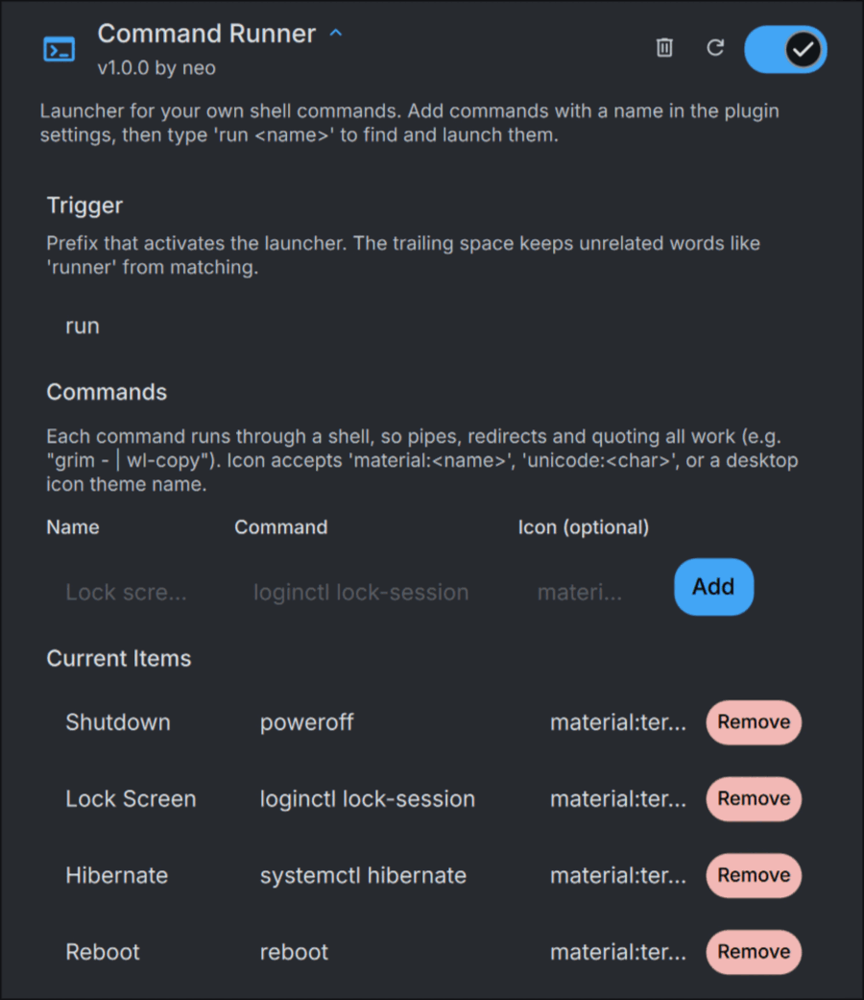

# Command Runner

A DankMaterialShell launcher plugin. Add commands with a name in the plugin's
settings, then type `run <name>` in the launcher to find and launch them.

```
run lock       →  runs "Lock screen" if that's what you named it
run            →  lists every configured command
```


## Install

Symlink it into the DMS plugin directory:

```sh
ln -s "$PWD/commandRunner" ~/.config/DankMaterialShell/plugins/commandRunner
```

The shell picks it up on its own (it watches the plugins directory). Enable
**Command Runner** under Settings → Plugins, then add commands under that same
settings panel.

## Adding commands

Settings → Plugins → Command Runner → Commands. Each entry has:

| Field | Required | Notes |
|---|---|---|
| Name | Yes | What you'll search for after the trigger |
| Command | Yes | Runs via `sh -c`, so pipes, redirects and quoting all work |
| Icon | No | `material:<name>`, `unicode:<char>`, or a desktop icon theme name. Defaults to `material:terminal` |



Example — a screenshot-to-clipboard command needs the shell for its pipe:

```
Name:    Screenshot region
Command: grim -g "$(slurp)" - | wl-copy
```

Commands are stored in this plugin's settings, not in the repo — nothing here
needs editing to add or remove one.

## Behavior

- `getItems(query)` filters your configured commands by name or command text
  (case-insensitive substring match); an empty query lists all of them.
- Selecting one runs `sh -c "<command>"` via `Quickshell.execDetached` —
  fire-and-forget, same as the launcher's own app entries. Output isn't
  captured; use a command that notifies or writes to a file if you need to see
  the result.
- Right-click (or the action panel) offers "Copy command" for pasting
  elsewhere.
- No commands configured yet, or nothing matches the query, both show an
  explanatory row instead of an empty list.
- Editing the command list while the launcher is open refreshes it immediately
  — no rescan or reload needed.

## Phone commands

Set up an Android phone under **Settings → Plugins → Command Runner → Phone**
and it gets commands of its own, beside yours:

| Setting | Example | |
|---|---|---|
| Phone name | `Logos` | what the commands are called; empty turns them off |
| adb address | `100.70.50.3:5555` | where it answers adb over the network; empty is USB only |
| Hotspot Wi-Fi name | | empty asks the phone (root), else uses the phone name |

```
run logos hot      →  Logos: Hotspot on, and connect
run logos          →  every Logos command
run phone battery  →  Logos: Battery
```

| Command | What it does |
|---|---|
| Hotspot on, and connect | turns on the phone's hotspot and connects this computer to it |
| Hotspot off | turns the hotspot off |
| Show screen | the phone's screen in a window you can use (scrcpy) |
| Screenshot | a screenshot of the phone, on the clipboard and in `~/Pictures/Screenshots` |
| Get newest photo | the newest camera photo or screenshot, on the clipboard and in `~/Downloads` |
| Send newest download | the newest file in `~/Downloads`, to the phone's Download folder |
| Open clipboard link | opens the copied link on the phone, and wakes its screen |
| Battery | level, charging and temperature |
| Do Not Disturb on/off | silences the phone (priority only), or lets it ring again |
| Lock screen | turns the phone's screen off |
| Connect adb | reaches the phone, and turns wireless adb back on when it is on a cable |

They are all [`scripts/phone.sh`](scripts/phone.sh), which reports every outcome
as a notification. Right-click a command and **Copy command** for the same
thing as a line for a terminal or a compositor keybind.

**Which way it reaches the phone.** The adb address first, then a phone on a
USB cable. Wireless adb goes off when the phone restarts (unless it is set up
to stay on); plug it in and run **Connect adb**, which turns it back on, and
the cable can go.

**The hotspot.** If the hotspot is already on, this computer just joins it —
no adb needed, which matters when this computer has no other network to reach
the phone over. Otherwise the phone is asked to turn it on, the same way its
own quick-settings toggle does, and the computer joins as soon as the network
shows up. To join it uses the NetworkManager profile you already have for the
network. If you have never joined it, it reads the hotspot's password off the
phone (root only) and NetworkManager keeps it from then on.

Android has no shell command for a hotspot that shares the internet, so the
script calls the phone's tethering service directly; the comment above
`tether_on` explains the call. It needs Android 11 or newer; it was tried on
Android 16 (LineageOS). Android turns an unused hotspot off by itself after a
while, unless that is switched off in its hotspot settings.

**Needs:** `adb` (Android platform tools); `scrcpy` for Show screen;
NetworkManager (`nmcli`) for the hotspot.

## Trust boundary

Commands run exactly as typed, with no sanitization — that's the point, it's a
personal command launcher, not something that accepts untrusted input. Anyone
who can write to this plugin's settings (i.e. anyone with your user account)
can already run arbitrary commands anyway. Don't paste commands from sources
you wouldn't otherwise run.
