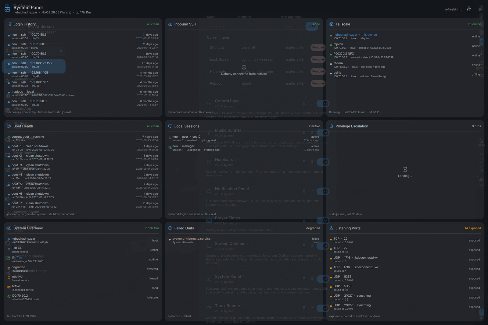

# System Panel

A fullscreen system panel for Phoenix / DankMaterialShell, focused on
answering "who has touched this machine, and is it healthy?" — on two pages:
**This machine**, a 3×3 grid read straight from this host, and **All machines**,
every `matrix log` kind from every host matrix knows.



## Tiles

| | | |
|---|---|---|
| **Login History** — every successful login plus failed SSH attempts, with user, method, source host and relative time | **System Errors** — priority ≤ err journal activity system-wide, deduplicated by unit + message | **Tailscale** — every device in the tailnet, online state, address, direct/relay path, last seen |
| **Boot Health** — recent boots with runtime, clean/unclean status, and the error lines for boots that ended badly | **File Actions** — file operations in progress (cp/mv/rsync/trash), plus their recent history | **Privilege Escalation** — sudo activity including denied attempts |
| **System Overview** — host, OS, kernel, uptime, systemd state, firewall, sshd, tailscale address | **Failed Units** — `systemctl --failed` and overall system state | **Listening Ports** — what this box exposes, and to which address |

**System Errors** vs. **Failed Units**: they deliberately don't overlap. Failed
Units is `systemctl --failed` — units systemd has already given up on. System
Errors is the journal at priority `err` and above, system-wide — it catches a
unit still logging errors while technically "active", kernel messages, and
anything outside a unit entirely. Repeated identical lines collapse into one
row with a `×N` count instead of flooding the tile.

**File Actions** reuses the `fileActions` plugin's model wholesale (see
`FileActionsData.qml`, `actions.js`, `scripts/live.sh`, `scripts/history.sh`,
all vendored copies): a live status file under
`$XDG_RUNTIME_DIR/matrix/fct` (or `matrix/dejavu`, the pre-rename name, when
that is the one that exists) answers "what's running now" and is deleted the
moment an action ends, so the "Recent" section below it comes from the event
log (`~/.local/state/fct.json`, falling back to the journal) instead.

The vendored copies have to be kept in step with `fileActions` by hand. They
had fallen behind its fix for a header line landing inside a status file's
JSON: with both `fct` and `dejavu` present, the second directory's `ok:` line
was printed straight after the first directory's last file, that file failed
to parse, and a copy in flight was missing from the tile. `actions.js` and
`scripts/live.sh` are byte-identical to the `fileActions` ones again.

## All machines

The second page (**Tab**, or **2**, or the chip in the header) is
`matrix log <kind> --json` for eight kinds, one tile each, four across and two
down:

| | | | |
|---|---|---|---|
| **System Errors** — journald `err`..`emerg` | **Logins** — sshd and logind, said the short way ("neo · ssh publickey from 100.70.50.1") | **Boots** — clean or unclean, and how long each ran | **NixOS Builds** — generation and NixOS version |
| **Sync & Backups** — sync-backup-manager's rsync and borg runs, Syncthing per folder | **File Operations** — cp, mv, rm, curl, wget, scp, git clone from the fct wrappers | **Network Devices** — every device the local-network scans saw | **Log Service** — the log-persisting service itself |

matrix fans out over ssh to every host it knows and merges their records
newest first; every row names the machine it came from. The same thing
happening again — the same error, the same device seen by every scan, the same
boot written by every later logger run, the same file removed every quarter
hour — is one row with a `×N` count. Chips above the tiles narrow every tile to
one machine.

A host that does not answer is not silently missing: matrix says so on stderr,
and the tile's footer and its chip say "unreachable". A kind can take twenty
seconds when a host is slow, so at most three kinds run at once, each tile
keeps its last answer while the next one is on its way, and a refresh that
fails leaves the old rows up with the reason in the footer.

The page is read only once it is looked at — opening the panel does not ssh
anywhere — and then every 2 minutes while it is on screen (with **Auto
refresh** on). The panel reopens on whichever page it was closed on.

How each record becomes a row is in `matrix.js`, as pure functions tested
against real `matrix log` output: `node tests/matrix.test.js` runs a live
`matrix log` for every kind, or `node tests/matrix.test.js DIR` reads saved
`<kind>.json` files.

## Data sources

Everything runs as the logged-in user; no root and no helper daemon.

| Tile | Source |
|---|---|
| Login history (successes) | `last -w --time-format iso` (wtmp) |
| Login history (failures) | `journalctl -t sshd -t sshd-session` |
| Boot health | `journalctl --list-boots` + `journalctl -t systemd-shutdown` |
| Tailscale | `tailscale status --json` |
| System errors | `journalctl -p 3 -o json`, deduplicated by unit + message |
| File actions (live) | `scripts/live.sh` — cats `$XDG_RUNTIME_DIR/matrix/fct/*.json` (or `matrix/dejavu`, whichever exists first) |
| File actions (history) | `scripts/history.sh` — `~/.local/state/fct.json` / `dejavu.json`, falling back to `journalctl -t matrix-fct -t matrix-dejavu` |
| Privilege escalation | `journalctl -t sudo` |
| Failed units | `systemctl list-units --failed --output=json` |
| Listening ports | `ss -tulnHp` |
| Overview | `hostname`, `uname`, `/proc/uptime`, `/etc/os-release`, `systemd-analyze`, `systemctl is-active` (the firewall counts as active when any of `firewall`, `nftables`, `iptables` is) |
| All machines | `matrix log <kind> --json --limit 200`, for `system`, `login`, `boot`, `build`, `sync`, `file`, `network-device` and `logger` |

Failed logins come from the journal rather than `lastb`, because `/var/log/btmp`
is root-only. Nothing is lost — sshd records invalid users and failed auth there.

A boot counts as **unclean** when its boot id never logged a `systemd-shutdown`
message. Error context is fetched only for those boots, one at a time, so a long
boot history does not fan out into dozens of processes.

## Install

The plugin is not installed automatically. Symlink `systemPanel` into
`~/.config/DankMaterialShell/plugins/` and enable it:

```sh
ln -sfn "$PWD/systemPanel" ~/.config/DankMaterialShell/plugins/systemPanel
SHELL_PATH=$(quickshell list --all | grep -oE '/run/user/[0-9]+/danklinux-shell/[a-f0-9]+' | head -1)
quickshell -p "$SHELL_PATH" ipc call plugin-scan scan
quickshell -p "$SHELL_PATH" ipc call plugins enable systemPanel
```

Then add the **System Panel** widget to the bar under Settings → DankBar, or
bind the IPC call below to a key.

## Usage

```sh
quickshell -p <shell-path> ipc call systemPanel toggle   # also: open, close, status
quickshell -p <shell-path> ipc call systemPanel matrix   # open on the all-machines page
```

`status` reports whether the panel holds keyboard focus (`keyboard=ready`),
which is useful when debugging compositor focus behaviour, and which page it is
on.

Inside the panel: **Esc** or **q** closes, **Ctrl+R** / **F5** refreshes the
page on screen, **Tab** switches pages, **1** and **2** pick one.

## Settings

| Key | Default | Meaning |
|---|---|---|
| `autoRefresh` | `true` | Re-run every local collector every 30s while open, and the all-machines page every 2 minutes while it is on screen |
| `journalDays` | `30` | How far back to read the journal for failed logins, system errors and sudo activity |

## Implementation notes

Two things about the plugin system are worth knowing before editing this:

1. **A `PanelWindow` declared inline inside a `PluginComponent` never becomes a
   layer surface.** It has to be created by a `LazyLoader` (as here) or
   `createObject(null)`. There is no error message when you get this wrong — the
   window is simply never mapped.

2. **On Hyprland, layer-shell exclusive keyboard focus is ignored** by the shell's
   default configuration, which uses `hyprland_focus_grab` instead. The window
   mirrors the shell's own policy via `KeyboardFocus.keyboardFocus()` plus
   `DankFocusGrab`; hardcoding `WlrKeyboardFocus.Exclusive` silently leaves the
   panel unable to receive Esc.

Reloading during development is also worth noting: `plugin-scan reload` only
cache-busts the plugin's **entry** component. Nested files (`SystemPanelWindow.qml`,
`SystemData.qml`, the tiles) stay in the QML type cache, so edits to them do not
take effect until the shell restarts — or until the plugin is mounted under a new
directory name, which changes every nested URL.
